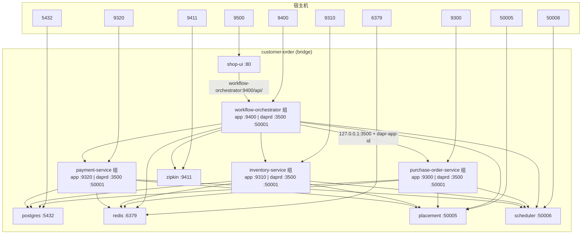

# Workflow Demo 网络拓扑

本文描述 `demos/workflow/docker-compose.yml` 在 Docker 中的网络结构与端口，便于理解 **Sidecar 共享网络**、**多组 3500 为何不冲突** 以及 **请求实际走哪些端口**。

Compose 启动：

```bash
docker compose -f demos/workflow/docker-compose.yml up --build
```

约定：**宿主机端口 → 容器端口**（`ports` 左为宿主机、右为容器）。未配置 `ports` 的服务/端口仅在 Docker 网络或「应用 + Sidecar」组内可达。

---

## 1. 总览

- 所有**独立容器**接入 bridge 网络 **`customer-order`**，通过 Compose **服务名**（如 `postgres`、`workflow-orchestrator`）互访。
- 四个 Java 微服务各有一个 **`daprd`** Sidecar，使用 `network_mode: service:<主容器>`，与主容器**共享同一网络命名空间**；在 `customer-order` 上表现为**一个 IP / 一个 DNS 名**。
- **`shop-ui`** 无 Sidecar，通过 HTTP 直连 **`workflow-orchestrator:9400`**。



---

## 2. Sidecar 与「多组 3500」

### 2.1 `network_mode: service:<主容器>`

Sidecar 容器不单独加入 `customer-order`，而是挂载到主容器的网络栈上。效果类似 Kubernetes 中 **一个 Pod 内 app + daprd**：

| 能力 | 说明 |
|------|------|
| 共享 `127.0.0.1` | 应用访问 `127.0.0.1:3500` 即本组 `daprd`；daprd 用 `-app-port` 回调 `127.0.0.1:<应用端口>` |
| 共享 bridge IP | 其它容器解析 `inventory-service` 等 hostname 时，得到的是**该组**在 `customer-order` 上的地址 |
| `ports` 映射 | 只能写在**主容器**上；Sidecar 不能再单独 publish |

### 2.2 为何每组 Sidecar 都可以用 3500？

端口在**网络命名空间**内唯一，不是整台宿主机全局唯一。

- **组与组之间**：各自独立命名空间，每组内各有一个 `daprd` 监听 **3500**，互不冲突。
- **组内**：应用端口（如 **9400**）与 Sidecar（**3500**、**50001**）必须不同，由 `-app-port` 与 daprd 默认端口分工。
- **宿主机**：本 demo **未**映射 3500；若两个容器都写 `3500:3500` 才会在宿主机上冲突。

`workflow-orchestrator` 显式配置：

```yaml
DAPR_HTTP_HOST: 127.0.0.1
DAPR_HTTP_PORT: 3500
```

与 `application.yml` 中 `dapr.http.host` / `dapr.http.port` 一致；其它带 Sidecar 的服务若通过本机 HTTP 调 Dapr，同样是**本组** `127.0.0.1:3500`。

---

## 3. 基础设施（单容器，无 Sidecar）

| Compose 服务名 | 容器端口 | 宿主机映射 | 用途 |
|----------------|----------|------------|------|
| `placement` | 50005 | 50005 → 50005 | Dapr Placement |
| `scheduler` | 50006 | 50008 → 50006 | Dapr Scheduler（Sidecar 连接 `scheduler:50006`） |
| `redis` | 6379 | 6379 → 6379 | State Store、Pub/Sub（见 `dapr-components/`） |
| `zipkin` | 9411 | 9411 → 9411 | 追踪（Sidecar → `http://zipkin:9411/api/v2/spans`） |
| `postgres` | 5432 | 5432 → 5432 | 业务库（见下表） |

Dapr 组件与基础设施地址（`dapr-components/`）：

| 组件文件 | 类型 | 连接 |
|----------|------|------|
| `statestore-redis.yaml` | `state.redis` | `redis:6379` |
| `pubsub-redis.yaml` | `pubsub.redis` | `redis:6379` |
| `config.yaml` | tracing | `http://zipkin:9411/api/v2/spans` |

PostgreSQL 库（JDBC 均指向 `postgres:5432`）：

| 服务 | 数据库名 |
|------|----------|
| purchase-order-service | `purchase_order_db` |
| inventory-service | `inventory_db` |
| payment-service | `payment_db` |

---

## 4. 业务服务：应用 + Dapr Sidecar

每组 **daprd** 默认监听：**3500**（HTTP API）、**50001**（gRPC）。Sidecar 启动参数中统一连接 **`placement:50005`**、**`scheduler:50006`**，并加载 `/dapr-components`。

| 主容器（DNS 名） | Dapr `app-id` | 应用端口 | 组内 Sidecar 端口 | 宿主机映射 |
|------------------|---------------|----------|-------------------|------------|
| `purchase-order-service` | `purchase-order-service` | 9300 | 3500, 50001 | 9300 → 9300；50003 → 50001（gRPC 调试） |
| `inventory-service` | `inventory-service` | 9310 | 3500, 50001 | 9310 → 9310；50004 → 50001 |
| `payment-service` | `payment-service` | 9320 | 3500, 50001 | 9320 → 9320；50007 → 50001 |
| `workflow-orchestrator` | `workflow-orchestrator` | 9400 | 3500, 50001 | 9400 → 9400；50006 → 50001 |

Orchestrator 配置的下游 `app-id`（`application.yml` → `commerce.*`）：

| 配置项 | `app-id` |
|--------|----------|
| `purchase-order-app-id` | `purchase-order-service` |
| `inventory-app-id` | `inventory-service` |
| `payment-app-id` | `payment-service` |

---

## 5. 前端（无 Dapr）

| 服务 | 容器端口 | 宿主机映射 | 出站 |
|------|----------|------------|------|
| `shop-ui` | 80（nginx） | 9500 → 80 | 反代 `http://workflow-orchestrator:9400/api/`（见 `shop-ui/nginx.conf`） |

浏览器通常只访问 **http://localhost:9500**；API 在容器网内直达 orchestrator **9400**，不经过 Sidecar 的 3500。

---

## 6. 典型流量路径

### 6.1 用户经 UI 访问

```text
浏览器 localhost:9500
  → shop-ui :80
  → workflow-orchestrator:9400/api/...
```

### 6.2 Service Invocation（Orchestrator 调库存等）

应用内 `DaprInvocationClient` 请求本组 Sidecar，由 Dapr 按 `dapr-app-id` 转发到目标服务的 Sidecar，再回调目标应用端口：

```text
workflow-orchestrator 进程
  → http://127.0.0.1:3500/...  +  Header: dapr-app-id: inventory-service
  →（Placement / 服务发现）→ inventory-service 组上的 daprd
  → http://127.0.0.1:9310/...  → inventory-service 进程
```

### 6.3 Dapr Workflow（Saga）

- 编排在 **`workflow-orchestrator`** 侧：Workflow SDK + 本组 Sidecar，Scheduler **`scheduler:50006`**，状态等经 **`redis:6379`**（`statestore`）。
- Activity 内对订单 / 库存 / 支付的调用仍经 **本组 3500** + 对应 `app-id`（与 6.2 相同模式）。
- 宕机后实例如何 **replay**、Scheduler 与 Redis 各自职责见 **[README-workflow-durability.md](./README-workflow-durability.md)**。

### 6.4 直连数据库

```text
purchase-order-service → jdbc:postgresql://postgres:5432/purchase_order_db
inventory-service      → jdbc:postgresql://postgres:5432/inventory_db
payment-service        → jdbc:postgresql://postgres:5432/payment_db
```

---

## 7. 宿主机端口速查

| 宿主机端口 | 目标 |
|------------|------|
| 9500 | shop-ui |
| 9400 | workflow-orchestrator HTTP |
| 9300 / 9310 / 9320 | purchase-order / inventory / payment HTTP |
| 50006 / 50003 / 50004 / 50007 | 各组 daprd gRPC（容器内 50001） |
| 50005 | Dapr Placement |
| 50008 | Dapr Scheduler（容器内 50006） |
| 6379 | Redis |
| 5432 | PostgreSQL |
| 9411 | Zipkin |

**未映射到宿主机：** 各 Sidecar 的 **3500**（Dapr HTTP，仅组内或通过该组 bridge IP 访问）。

---

## 8. 逻辑分层（ASCII）

```text
                    [ 宿主机 ]
   9500          9400    9300/9310/9320    5432 6379 9411 50005 50008
     |             |         |              基础设施（customer-order DNS）
 shop-ui ----HTTP---- workflow-orchestrator 组
                           |
                     127.0.0.1:3500 (本组 daprd)
                           |
              Dapr invoke / workflow / state / pubsub
                           |
         +-----------------+------------------+
         v                 v                  v
   purchase-order    inventory         payment
   组 :9300+:3500    组 :9310+:3500    组 :9320+:3500
         \                 |                  /
          \------ postgres:5432 ------------/
          \------ redis:6379 (via daprd) ---/
          \------ placement / scheduler ----/
```

---

## 相关文档

- [README.md](./README.md) — 子 demo 入口
- [README-detail.md](./README-detail.md) — Saga 步骤与业务说明
- [quickstart.md](./quickstart.md) — 快速上手
