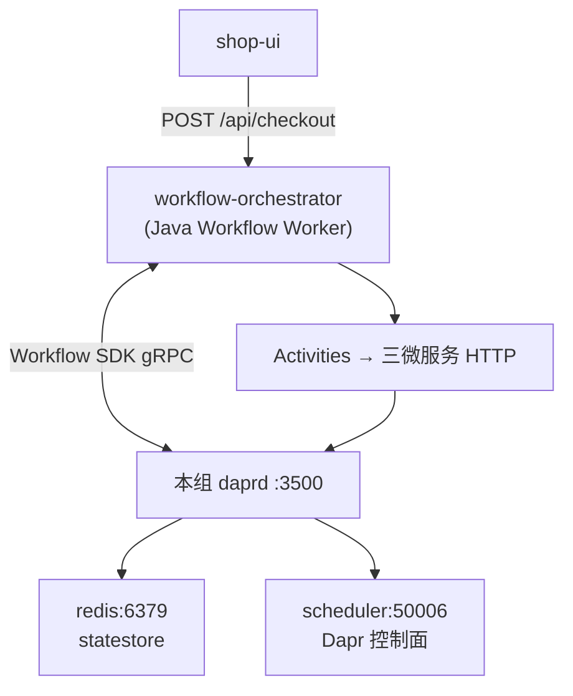

# Dapr Workflow 持久化与宕机恢复

本文说明本 demo 中 **PurchaseSagaWorkflow** 在进程崩溃、容器重启等场景下如何恢复，以及 **Scheduler / Redis / Sidecar** 各自扮演的角色。编排实现见 [PurchaseSagaWorkflow](./workflow-orchestrator/src/main/java/com/github/wenqigilantz/service/orchestrator/workflow/PurchaseSagaWorkflow.java)。

## 结论（先读这段）

| 常见误解 | 实际机制 |
|----------|----------|
| Scheduler 从 Java「中断那一行」继续执行 | **否**。恢复由 **Workflow 运行时 + 持久化 history** 驱动，采用 **事件溯源 + 重放（replay）** |
| 宕机后从函数中间某条语句接着跑 | **语义上**是从最后一个已完成的 `await` 之后继续；**实现上**编排函数 **从开头重跑**，已完成 Activity **只读历史结果、不再调度** |
| Activity 与 Orchestration 一样会 replay | **否**。Activity **按 schedule 执行**（可能 **at-least-once**），需业务 **幂等** |

同一 **workflow instanceId** 在未 `complete` 前会自动恢复；已 `complete` 的实例不会再次执行。

---

## 1. 本 demo 中的组件分工



| 组件 | 作用（与本 Saga 相关） |
|------|-------------------------|
| **workflow-orchestrator** | 注册 Workflow / Activity；Worker 拉取 WorkItem，执行或 **重放** `PurchaseSagaWorkflow` |
| **daprd（Sidecar）** | Workflow 引擎：追加 history、调度 Activity、在恢复时触发 replay |
| **Redis（`statestore-redis`）** | 持久化 Workflow **执行历史** 等状态（见 [README-network-topology.md §6.3](./README-network-topology.md)） |
| **scheduler** | Dapr 1.14+ **控制面**（Jobs、可选 Reminder 等）；**不是**「从 PurchaseSagaWorkflow 第 N 行续跑」的断点调度器 |
| **placement** | Actor / Workflow 相关路由与发现 |

启动命令与端口见 [README-detail.md](./README-detail.md)、[README-network-topology.md](./README-network-topology.md)。

---

## 2. 检查点：`callActivity(...).await()`

Dapr Workflow 使用 **event sourcing**：不在内存里快照整段编排，而是追加 **history 事件**。

每次编排代码 **await** 一个已调度任务（本 demo 中为 `ctx.callActivity(...).await()`）时：

1. 运行时记录该步骤（调度 / 完成及结果）；
2. 编排逻辑可从内存卸载，直到 Activity 完成；
3. Activity 完成后，运行时 **再次调度编排函数** —— 这一次执行称为 **replay（重放）**。

重放时：

- 从 **编排 lambda 的第一行** 开始执行；
- 遇到 **已在 history 中完成** 的 Activity → **返回缓存结果**，**不会**再次 `ScheduleTask`；
- 直到遇到 **尚未完成** 的 `await`，或执行到 `ctx.complete(...)`。

因此：**持久化边界在 `await`，不是 Java 源码的任意一行。**

官方说明：[Workflow features — Workflow replay](https://docs.dapr.io/developing-applications/building-blocks/workflow/workflow-features-concepts/)

---

## 3. 宕机场景对照表

以下「编排进程」指 `workflow-orchestrator` JVM（含 Workflow Worker）；Sidecar / Redis 单独挂掉时行为类似，前提是恢复后 **同一 instanceId 的 history 仍在**。

| 宕机时刻 | History 中通常已有 | 恢复后行为 |
|----------|-------------------|------------|
| Step 1 CreateOrder **已完成** | Step 1 完成事件 | 重放跳过 Step 1，继续 Step 2 |
| Step 3 Charge **进行中**（HTTP 已发出） | 可能仅有「已调度」、尚无完成 | **可能重试** Charge Activity（at-least-once） |
| Activity **下游已成功**，Worker **未** `CompleteActivity` | 无完成事件 | 引擎认为未完成 → **可能再跑一次** Activity |
| 两次 `await` 之间的 **纯本地代码**（无新 `await`） | 无额外 checkpoint | 重放时会 **再执行** 这段；此处 **禁止** 不可重复副作用 |
| 已执行 `ctx.complete(output)` | 实例终态 | **不会** 再次执行该 instance |

Activity 生命周期与重试、幂等键说明：[Workflow Protocol — Activity Lifecycle](https://docs.dapr.io/contributing/protocol-reference/workflow-protocol/workflow-protocol-activity-lifecycle/)

---

## 4. PurchaseSaga 示例：Step 2 完成后、Step 3 扣款时宕机

```
时间线 ─────────────────────────────────────────────────────────────►

  [1 CreateOrder]     history ✓
  [2 Reserve]         history ✓
  [3 Charge]          …… orchestrator 崩溃
                           │
                           ▼ 容器 / 进程重启，instanceId 不变
  replay:
    Step 1  → 读 history，不调 purchase-order-service
    Step 2  → 读 history，不调 inventory-service
    Step 3  → 若 history 无完成记录 → 再次调度 ChargePaymentActivity
```

编排分支（库存不足 / 支付失败 / 成功）在重放时 **按相同 history 走同一路径**；编排代码须 **确定性**（相同输入与 history → 相同调度顺序）。见 [Workflow patterns](https://docs.dapr.io/developing-applications/building-blocks/workflow/workflow-patterns/)。

---

## 5. 本 demo 的业务幂等（配合 Activity 重试）

跨服务关联键：**`workflowId` = Dapr Workflow `instanceId`**（见 `PurchaseSagaWorkflow` 中 `ctx.getInstanceId()`）。

| 服务 | 幂等方式（节选） |
|------|------------------|
| purchase-order-service | `createOrder`：`findByWorkflowId`，已有则直接返回 |
| inventory-service | `reserve`：`reservationRepository.findById(workflowId)` |
| payment-service | `charge`：`paymentRepository.findById(workflowId)` |

Activity 被重试时，一般不会重复建单或重复扣款；补偿接口（取消、释放）亦应按 `workflowId` / 订单 id 设计为可安全重复调用。

---

## 6. 运维与边界条件

### 6.1 Redis 数据必须保留

History 落在 **Redis statestore**。若清空 Redis 卷或换空实例，**无法** 对旧 instanceId 做 replay，表现为实例丢失或无法查询进度。

### 6.2 Scheduler 不等于 Workflow 续跑

Compose 中的 `dapr-scheduler`（宿主机 **50008** → 容器 **50006**）是 Dapr 集群调度基础设施。本 demo 的 `dapr-components/config.yaml` **未** 开启 `SchedulerReminders` 等可选特性；**Saga 续跑不依赖「Cron 式 Scheduler」**，而依赖 Sidecar + Redis history + Worker 重连。

### 6.3 谁拉起「下一次」编排执行？

- **不是** shop-ui 轮询 `/api/checkout/status` 触发续跑（轮询仅 **读** 状态）；
- **是** Dapr Workflow 运行时在 Activity 完成或故障恢复后，向 Worker **投递 replay / work item**。

### 6.4 本地验证思路（可选）

1. 正常下一单，记下响应中的 **instanceId**。
2. 在 Step 3 前后 `docker compose restart workflow-orchestrator`（或 kill 进程）。
3. 继续轮询同一 instanceId：应最终 **Completed**，且订单/库存/支付与 happy path 一致（无重复扣款可查 payment 表 `workflow_id`）。

---

## 7. 与 Saga 补偿的关系

- **业务补偿**（库存不足、支付失败）：编排内显式 `CancelOrder` / `ReleaseInventory`，结果写入 `SagaWorkflowResult`（`compensated: true`）。
- **基础设施恢复**（进程崩溃）：由 **replay** 保证「已完成的正向步骤不重复执行」；未完成步骤继续或重试 Activity。

二者正交：补偿是 **业务失败路径**；replay 是 **运行时故障路径**。

---

## 8. 参考链接

- [Dapr Workflow 概述](https://docs.dapr.io/developing-applications/building-blocks/workflow/)
- [Features and concepts（含 replay）](https://docs.dapr.io/developing-applications/building-blocks/workflow/workflow-features-concepts/)
- [Workflow patterns（自动保存进度、从最后完成步骤恢复）](https://docs.dapr.io/developing-applications/building-blocks/workflow/workflow-patterns/)
- 本仓库：[README-detail.md](./README-detail.md)（Saga 步骤）、[README-network-topology.md](./README-network-topology.md)（Redis / Scheduler 拓扑）
