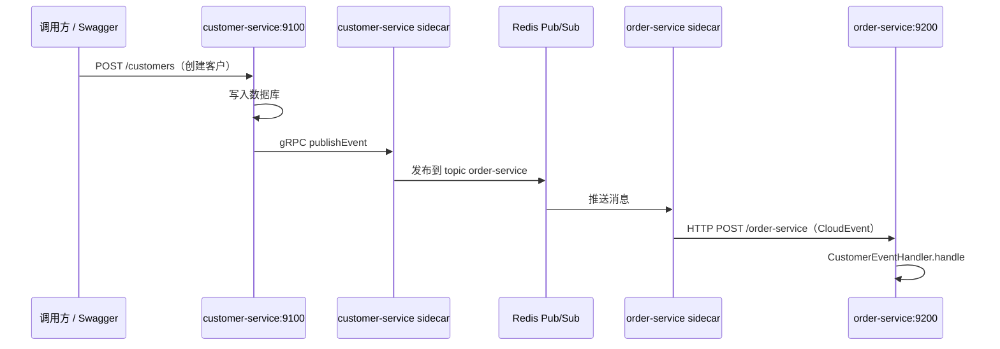

# Dapr 发布订阅（Pub/Sub）实现说明

本文档说明本仓库中 **Customer Service → Order Service** 的客户生命周期事件如何通过 Dapr Pub/Sub 传递。

相关官方参考：[Dapr Pub/Sub 快速入门](https://docs.dapr.io/getting-started/quickstarts/pubsub-quickstart/)。

---

## What（是什么）

| 概念 | 在本项目中的取值 |
|------|------------------|
| **Pub/Sub 组件名** | `customer-order-integration`（见 `dapr-components/pubsub-redis.yaml`） |
| **Topic** | `order-service` |
| **消息中间件** | Redis（Compose 中的 `redis` 服务） |
| **发布方** | `customer-service`（客户创建 / 更新 / 删除后发布事件） |
| **订阅方** | `order-service`（收到事件后执行业务逻辑） |
| **事件类型** | `CustomerWasCreated`、`CustomerWasUpdated`、`CustomerWasDeleted` |

发布方不直接调用 Order Service 的 HTTP 接口，而是把事件写入 Topic；Dapr sidecar 与 Redis 负责路由，订阅方应用只处理投递到本地的 CloudEvent。

---

## Why（为什么用 Pub/Sub）

1. **解耦**：Customer Service 持久化客户数据后只需「发事件」，不必知道有多少下游、下游是否在线；Order Service 可独立部署、扩缩容。
2. **异步**：写库与通知下游分离，创建客户的 API 不必等待 Order Service 处理完毕（本项目中 `publishEvent` 在请求线程内同步等待 sidecar 确认，仍比直连 HTTP 耦合度低；生产环境可进一步改为完全异步或 Outbox）。
3. **统一基础设施**：换 Kafka、RabbitMQ 等只需改 Dapr Component YAML，应用侧仍使用 `publishEvent` / `@Topic`。
4. **契约可测**：事件结构与 Pact 契约（`customer-service/rest-controller/src/test/resources/pacts/`）对齐，便于跨团队约定消息格式。

---

## How（怎么跑通）

### 架构与数据流



### 基础设施

1. **Dapr 组件** — Redis 作为 pubsub 后端：

```yaml
# dapr-components/pubsub-redis.yaml
apiVersion: dapr.io/v1alpha1
kind: Component
metadata:
  name: customer-order-integration
spec:
  type: pubsub.redis
  version: v1
  metadata:
    - name: redisHost
      value: redis:6379
```

2. **Sidecar 与网络** — `docker-compose.yml` 中：
   - 每个应用有独立 `daprd` 容器，`network_mode: service:<app>`，与应用 **共享网络命名空间**。
   - Customer Service 内 Java SDK 默认连 `127.0.0.1:50001`（gRPC）发事件；因此 sidecar 必须与 app 成对启动，不能只重启 app 容器（见 README 故障说明）。

3. **订阅注册** — Order Service 使用 `dapr-sdk-springboot` 的 `@Topic` 注解；应用启动后 sidecar 会向 Spring 应用注册订阅，**无需** 单独的 `Subscription` CRD/YAML。

---

## 关键代码

### 1. 发布事件（Customer Service）

常量与组件名、Topic 名必须与 YAML 及订阅方一致：

```java
private static final String MESSAGE_TTL_IN_SECONDS = "1000";
private static final String TOPIC_ORDER_SERVICE = "order-service";
private static final String PUBSUB_NAME = "customer-order-integration";
```

创建客户：先落库，再构建事件并通过 `DaprClient` 发布（更新、删除同理）：

```java
CustomerWasCreated customerWasCreated = CustomerWasCreated.builder()
        .customerId(customerInfo.getCustomerId())
        .firstName(customerInfo.getFirstName())
        .lastName(customerInfo.getLastName())
        .status(CustomerStatus.CREATED)
        .build();

try (DaprClient client = new DaprClientBuilder().build()) {
    client.publishEvent(
            PUBSUB_NAME,
            TOPIC_ORDER_SERVICE,
            customerWasCreated,
            singletonMap(Metadata.TTL_IN_SECONDS, MESSAGE_TTL_IN_SECONDS)).block();
}
```

**文件位置**：`demos/发布订阅/customer-service/src/main/java/com/github/wenqiglantz/service/customerservice/service/impl/CustomerServiceImpl.java`

**事件 POJO 示例**（字段顺序与 Pact 一致）：

```java
@JsonPropertyOrder({"customerId", "firstName", "lastName", "status"})
public class CustomerWasCreated {
    private String customerId;
    private String firstName;
    private String lastName;
    private CustomerStatus status = CustomerStatus.CREATED;
}
```

Order Service 侧用更宽松的 `CustomerEvent`（含 `status` 字符串）反序列化三种事件，见 `demos/发布订阅/order-service/.../event/CustomerEvent.java`。

### 2. 订阅事件（Order Service）

Dapr 将消息以 **CloudEvents** 形式 POST 到应用；`@Topic` 绑定 pubsub 名与 topic 名，路径 `/order-service` 为 sidecar 投递端点：

```java
private static final String PUBSUB_NAME = "customer-order-integration";
private static final String TOPIC_ORDER_SERVICE = "order-service";

@Topic(name = TOPIC_ORDER_SERVICE, pubsubName = PUBSUB_NAME)
@PostMapping(path = "/order-service", consumes = MediaType.ALL_VALUE)
public Mono<ResponseEntity<String>> onCustomerEvent(
        @RequestBody(required = false) CloudEvent<CustomerEvent> cloudEvent) {
    // 解析 cloudEvent.getData()，调用 customerEventHandler.handle(event)
    return Mono.fromSupplier(() -> ResponseEntity.ok("SUCCESS"));
}
```

**文件位置**：`demos/发布订阅/order-service/src/main/java/com/github/wenqigilantz/service/orderservice/web/CustomerEventSubscriber.java`

处理逻辑（当前示例：打日志；并触发一次服务调用拉取最新客户，见 [服务调用文档](./dapr-service-invocation.md)）：

```java
public void handle(CustomerEvent event) {
    CustomerInfo customer = customerServiceInvocationClient.getCustomer(event.getCustomerId());
    log.info("Service invocation passed: customerId={}, ...", customer.getCustomerId(), ...);
}
```

**文件位置**：`demos/发布订阅/order-service/.../service/CustomerEventHandler.java`

### 3. Maven 依赖

两端均引入：

```xml
<dependency>
    <groupId>io.dapr</groupId>
    <artifactId>dapr-sdk</artifactId>
</dependency>
<dependency>
    <groupId>io.dapr</groupId>
    <artifactId>dapr-sdk-springboot</artifactId>
</dependency>
```

Order Service 侧 Spring Boot 集成主要用于 `@Topic`；Customer Service 发布仅使用 `DaprClientBuilder`。

---

## 本地验证

1. 启动全栈：`docker compose up --build`
2. 在 Swagger 创建客户：http://localhost:9100/swagger-ui.html
3. 查看 Order Service 日志，应出现类似：
   - `Subscriber received: customerId=..., status=...`
   - `Processing customer event: ...`
   - （若 customer-service 可达）`Service invocation passed: ...`

---

## 常见问题

| 现象 | 原因 | 处理 |
|------|------|------|
| 创建客户 500，`Connection refused: 127.0.0.1:50001` | 应用容器已重建，sidecar 仍绑定旧网络 | `docker compose up -d --force-recreate customer-service customer-service-dapr` |
| 订阅方无日志 | sidecar 未起、Redis 不可达、或 pubsub/topic 名不一致 | 检查 Compose 四件套：redis、placement、app、app-dapr |
| 消息体为空 | CloudEvent 解析失败或投递格式异常 | 订阅方法已防御性判断 `cloudEvent.getData() == null` |

---

## 延伸阅读

- [Dapr Pub/Sub API](https://docs.dapr.io/developing-applications/building-blocks/pubsub/)
- [Dapr Java SDK - Publish & Subscribe](https://docs.dapr.io/developing-applications/sdks/java/java-client/#publish-and-subscribe-to-events)
- 本仓库 [服务调用](./dapr-service-invocation.md) — Order Service 在收到事件后如何查询 Customer Service
