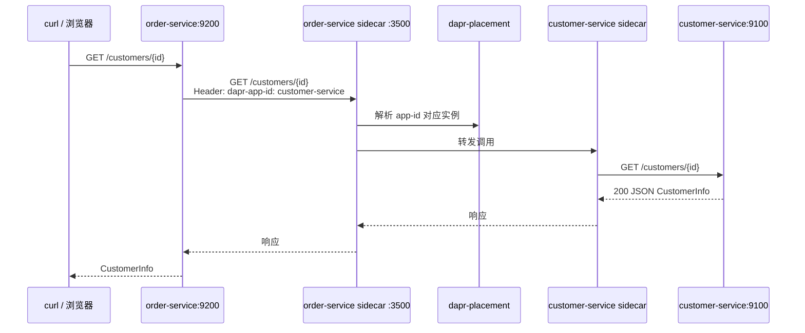

# Dapr 服务调用（Service Invocation）实现说明

本文档说明 **Order Service** 如何通过 Dapr sidecar **同步调用** **Customer Service** 的 REST API（`GET /customers/{customerId}`）。

相关官方参考：[Dapr Service Invocation 快速入门](https://docs.dapr.io/getting-started/quickstarts/serviceinvocation-quickstart/)。

---

## What（是什么）

| 概念 | 在本项目中的取值 |
|------|------------------|
| **调用方应用** | `order-service`（`app-id`: `order-service`） |
| **被调应用** | `customer-service`（`app-id`: `customer-service`） |
| **调用方式** | HTTP → **本机** Dapr sidecar（默认 `127.0.0.1:3500`） |
| **路由标识** | 请求头 `dapr-app-id: customer-service` |
| **实际 API** | `GET /customers/{customerId}`（由 sidecar 转发到 customer-service 的 9100 端口） |
| **封装类** | `CustomerServiceInvocationClient` |
| **对外暴露** | `CustomerQueryController` — `GET http://localhost:9200/customers/{id}` 作为 BFF/代理 |

服务调用是 **请求-响应、同步** 的：适合「根据 ID 读取最新客户快照」，与 Pub/Sub 的「事件通知」互补。

---

## Why（为什么用 Service Invocation）

1. **不硬编码下游地址**：Order Service 只访问 `127.0.0.1:3500` 和 `dapr-app-id`，无需在配置里写 `customer-service:9100`；在 Kubernetes 或多实例场景下由 Dapr + Placement 做服务发现。
2. **横切能力集中**： mTLS、重试、追踪、访问策略等可在 Dapr 层统一配置，业务代码保持普通 HTTP 客户端形态。
3. **与 Pub/Sub 组合**：事件里可能只有部分字段或存在延迟；收到 `CustomerWasUpdated` 后，再调用 GET 可拿到 **当前权威读模型**（本示例在 `CustomerEventHandler` 中演示该模式）。
4. **与快速入门一致**：使用 HTTP + `dapr-app-id` 头，便于对照官方文档排查问题。

---

## How（怎么跑通）

### 架构与数据流



**Compose 中的要点**（`docker-compose.yml`）：

- **placement** 服务（`50005`）：自托管环境下 sidecar 间发现需要 Placement。
- **`-dapr-listen-addresses 0.0.0.0`**：sidecar 在容器内监听所有接口，便于与共享网络的 app 通信。
- Order 容器映射 **`50002:50001`** 仅为宿主机调试 gRPC；**服务调用走 HTTP 3500**，应用在容器内仍用 `127.0.0.1:3500`（与 app 同 network namespace 的 sidecar）。

### 配置

```yaml
# demos/发布订阅/order-service/src/main/resources/application.yml
dapr:
  http:
    host: ${DAPR_HOST:127.0.0.1}
    port: ${DAPR_HTTP_PORT:3500}
  invocation:
    customer-service-app-id: customer-service
```

本地非 Compose 或多 sidecar 同机时，可通过环境变量调整 `DAPR_HTTP_PORT`（与 Dapr 快速入门中 checkout 服务相同）。

---

## 关键代码

### 1. 通过 sidecar 调用 Customer Service

核心思路：**URI 路径与被调服务一致**，但 **host:port 指向本地 sidecar**；用 **`dapr-app-id`** 指定目标应用：

```java
private static final String DAPR_APP_ID_HEADER = "dapr-app-id";

@Value("${dapr.http.host:127.0.0.1}")
private String daprHost;

@Value("${dapr.http.port:3500}")
private int daprHttpPort;

@Value("${dapr.invocation.customer-service-app-id:customer-service}")
private String customerServiceAppId;

public CustomerInfo getCustomer(String customerId) throws Exception {
    URI uri = URI.create(
            String.format("http://%s:%d/customers/%s", daprHost, daprHttpPort, customerId));

    HttpRequest request = HttpRequest.newBuilder()
            .GET()
            .uri(uri)
            .header("Content-Type", "application/json")
            .header(DAPR_APP_ID_HEADER, customerServiceAppId)
            .timeout(Duration.ofSeconds(10))
            .build();

    HttpResponse<String> response = httpClient.send(request, HttpResponse.BodyHandlers.ofString());
    if (response.statusCode() != 200) {
        throw new IllegalStateException("Customer service invocation failed: HTTP " + response.statusCode());
    }
    return objectMapper.readValue(response.body(), CustomerInfo.class);
}
```

**文件位置**：`demos/发布订阅/order-service/src/main/java/com/github/wenqigilantz/service/orderservice/client/CustomerServiceInvocationClient.java`

等价 curl（在 **order-service 容器内** 或与其共享 network namespace 的环境）：

```bash
curl -H "dapr-app-id: customer-service" \
  http://127.0.0.1:3500/customers/{customerId}
```

### 2. 对外 REST 代理（便于手工验证）

```java
@RestController
@RequestMapping("/customers")
@RequiredArgsConstructor
public class CustomerQueryController {

    private final CustomerServiceInvocationClient customerServiceInvocationClient;

    @GetMapping("/{customerId}")
    public ResponseEntity<CustomerInfo> getCustomer(@PathVariable String customerId) throws Exception {
        return ResponseEntity.ok(customerServiceInvocationClient.getCustomer(customerId));
    }
}
```

**文件位置**：`demos/发布订阅/order-service/.../web/CustomerQueryController.java`

宿主机验证：

```bash
curl http://localhost:9200/customers/{customerId}
```

### 3. 与 Pub/Sub 联动（收到事件后再拉取最新状态）

```java
public void handle(CustomerEvent event) {
    try {
        CustomerInfo customer = customerServiceInvocationClient.getCustomer(event.getCustomerId());
        log.info("Service invocation passed: customerId={}, firstName={}, lastName={}",
                customer.getCustomerId(), customer.getFirstName(), customer.getLastName());
    } catch (Exception ex) {
        log.warn("Service invocation to customer-service failed for customerId={}: {}",
                event.getCustomerId(), ex.getMessage());
    }
}
```

**文件位置**：`demos/发布订阅/order-service/.../service/CustomerEventHandler.java`

这体现了典型模式：**事件驱动触发 + 服务调用读模型**。

### 4. 被调方 API（Customer Service）

Sidecar 最终转发到 Spring MVC 控制器（路径 `/customers/{customerId}`）。实现位于 `customer-service` 的 `CustomerController` / `CustomerServiceImpl.getCustomer`，返回 `CustomerInfo` JSON，与 Order Service 的 `CustomerInfo` DTO 字段对齐（`customerId`、`firstName`、`lastName`）。

---

## 本地验证

| 步骤 | 命令 / 操作 |
|------|-------------|
| 1. 启动栈 | `docker compose up --build` |
| 2. 创建客户 | Swagger http://localhost:9100/swagger-ui.html |
| 3. 经 Order 代理查询 | `curl http://localhost:9200/customers/{customerId}` |
| 4. 经 Pub/Sub 触发调用 | 创建/更新客户后查看 order-service 日志中的 `Service invocation passed` |

---

## Pub/Sub 与服务调用的对比（在本项目中）

| 维度 | Pub/Sub | Service Invocation |
|------|---------|-------------------|
| 通信模式 | 异步、一对多（可扩展多个订阅者） | 同步、点对点 |
| 耦合 | 发布方不感知订阅方 | 调用方明确要调用的 `app-id` |
| 数据 | 事件 payload（可能非完整快照） | 通常返回当前 API 读模型 |
| 本仓库入口 | `CustomerServiceImpl.publishEvent` | `CustomerServiceInvocationClient.getCustomer` |
| SDK/协议 | gRPC → sidecar（发布） | HTTP → sidecar（调用） |

两者一起使用：**Pub/Sub 通知「发生了什么」**，**Service Invocation 查询「现在是什么」**。

---

## 常见问题

| 现象 | 可能原因 | 处理 |
|------|----------|------|
| HTTP 404 / 找不到 app | Placement 未启动、`app-id` 拼写错误 | 确认 `placement` 容器与 sidecar `-placement-host-address` |
| 连接 3500 失败 | sidecar 未与 order-service 成对运行 | 重建 `order-service` + `order-service-dapr` |
| 502 / 超时 | customer-service 未就绪或 app-port 配置错误 | 检查 `customer-service-dapr` 的 `-app-port 9100` |
| 200 但 body 解析失败 | DTO 字段不一致 | 对齐两端 `CustomerInfo` JSON 字段 |

---

## 延伸阅读

- [Dapr Service Invocation 概述](https://docs.dapr.io/developing-applications/building-blocks/service-invocation/)
- [自托管 Docker Compose 部署](https://docs.dapr.io/operations/hosting/self-hosted/self-hosted-with-docker/)
- 本仓库 [发布订阅](./dapr-pubsub.md) — 事件如何到达 Order Service
